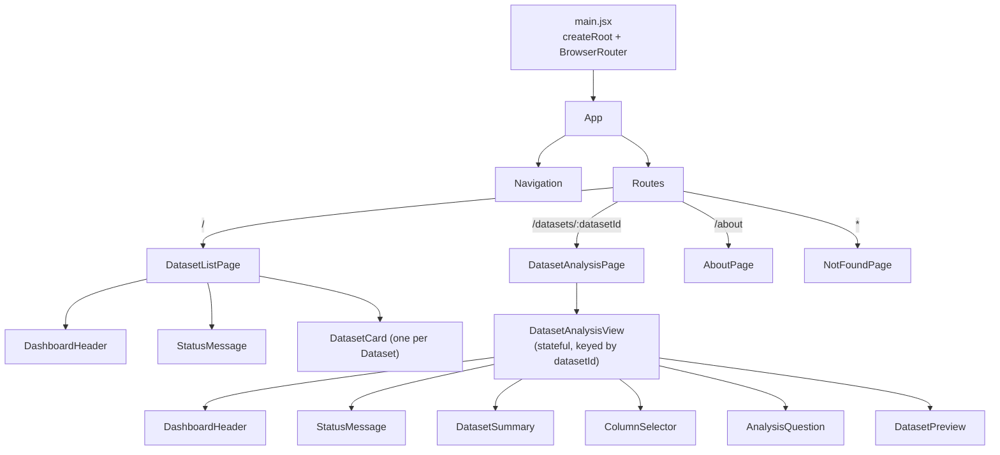
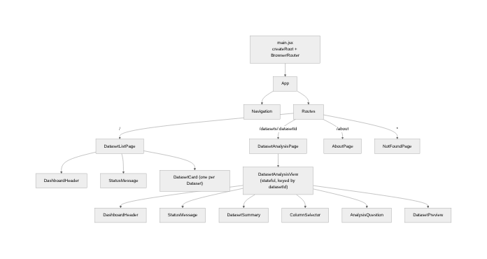

# Signal Component Tree (Feature 4)

Arrows point from a parent to the children it renders. Pages are chosen by
React Router based on the URL. Data flows **down** as props; user events flow
**up** through callbacks (`onColumnChange`, `onQuestionChange`, `onAnalyze`).



## Where data comes from

```
DatasetListPage      --getAllDatasets()-------------> DatasetModel    --Parse.Query--> Back4App
DatasetAnalysisView  --getDatasetById(id)-----------> DatasetModel    --Parse.Query--> Back4App
DatasetAnalysisView  --getRecordsForDataset(id)-----> DataRecordModel --Parse.Query--> Back4App
DatasetAnalysisView  --summarizeColumn(rows, col)---> dataAnalysisService (pure math, no Parse)
```

Components never create a `Parse.Query`; they only call model functions.


