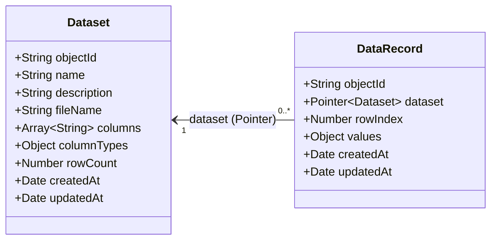
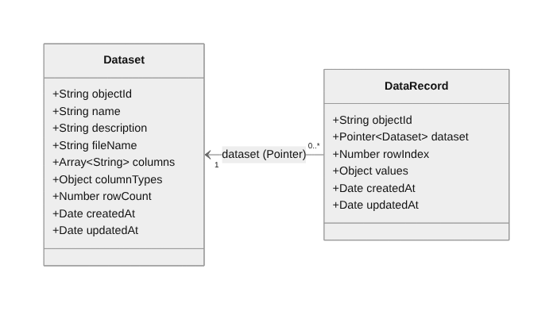

# Signal Data Model (UML)

Signal stores **any** structured dataset with two generic Parse classes.
Finance is only the seeded sample; the classes contain no finance fields.



## Relationship

- **One-to-many:** one `Dataset` has many `DataRecord`s; each `DataRecord`
  belongs to exactly one `Dataset`.
- **How it is stored:** a `Pointer<Dataset>` on `DataRecord.dataset` (the
  "many" side). Records for a dataset are fetched with
  `query.equalTo("dataset", pointer)` in `DataRecordModel.getRecordsForDataset`.
- **Why a Pointer and not an Array on Dataset (Rule of 10):** an array of
  pointers on the parent only makes sense when the "many" side stays small
  (around 10 or fewer). A dataset routinely has dozens to thousands of rows,
  so the pointer goes on the child. A many-to-many `Relation` is not needed
  because a row never belongs to more than one dataset.

## Field notes

| Class | Field | Type | Purpose |
|---|---|---|---|
| Dataset | name | String | Display name |
| Dataset | description | String | Short summary |
| Dataset | fileName | String | Original source file |
| Dataset | columns | Array | Column names in display order |
| Dataset | columnTypes | Object | `{ column: "number" \| "string" }` |
| Dataset | rowCount | Number | Number of DataRecords |
| DataRecord | dataset | Pointer&lt;Dataset&gt; | Owning dataset |
| DataRecord | rowIndex | Number | Original row order |
| DataRecord | values | Object | The row's cells, any keys |

Example `DataRecord.values` from two unrelated datasets, same class:

```json
{ "date": "2026-01-05", "ticker": "AAPL", "open": 242.1, "close": 245.3, "volume": 48192300 }
{ "city": "Chicago", "temperature": 72, "humidity": 48 }
```


